<div align="center">

# 🔧 AI-Powered Predictive Maintenance System for IoT Devices

**Predict machine failures *before* they happen — from raw IoT sensor streams to maintenance work orders.**

[](https://github.com/rohitsingh83/AI-Predictive-Maintenance-IoT/actions)
[](https://rohitsingh83.github.io/AI-Predictive-Maintenance-IoT/)


> 🌐 **Live Interactive Website & Digital Twin:** [https://rohitsingh83.github.io/AI-Predictive-Maintenance-IoT/](https://rohitsingh83.github.io/AI-Predictive-Maintenance-IoT/)

*No industrial machine? No problem — the project ships a physics-based virtual IoT fleet, and runs on a real Raspberry Pi rig if you have one.*

</div>

---

## 📌 Overview

Unplanned machine downtime is one of the most expensive problems in manufacturing. A single
failed motor on a production line can cost **tens of thousands of dollars per hour**.
Traditional maintenance is either **reactive** (fix it after it breaks) or **preventive**
(service it on a calendar, whether it needs it or not).

This project implements **predictive maintenance (PdM)** end-to-end: it reads IoT sensor
telemetry from rotating machinery, learns each machine's failure signature, and issues a
**work order ~1 hour before the machine would have failed**.

| | |
|---|---|
| 🎯 **Task** | Binary classification — will this machine fail within the next hour? |
| 📊 **Real dataset** | AI4I 2020 Predictive Maintenance (UCI) — 10,000 industrial production cycles |
| 🏭 **Virtual fleet** | 30 machines · 27,000 samples · 118 breakdowns, generated by a documented degradation model |
| 🤖 **Models** | Logistic Regression · Random Forest · Extra Trees · HistGradientBoosting (5-fold CV, best selected) |
| 🏆 **Result (real data)** | ROC-AUC **0.978** · PR-AUC **0.871** · Recall **0.81** · Precision **0.87** · F1 **0.840** |
| 🏆 **Result (unseen machines)** | F1 **0.958** · PR-AUC **0.995** · **100%** of breakdowns flagged in advance · avg. **0.9 h** notice |
| 💰 **Business case** | **$1.19M/yr** net saving on a 30-machine line (55%), payback in **2 days** (conservative floor: $675k / 32%) |
| 🧪 **Tests** | 10 pytest tests + GitHub Actions CI |
| ⚙️ **Stack** | Python · pandas · NumPy · scikit-learn · matplotlib/seaborn · Flask · joblib · Docker |

---

## ❓ Problem Statement

> A plant runs 30 machines. Each fails ~2× per year, and every unplanned stop costs
> **8 hours of lost production ($36,000)** plus emergency repair and collateral damage.
> Maintenance engineers can only watch a handful of gauges. **Can we read the sensors,
> learn the pre-failure signature and tell the crew which machine to service, before it
> stops the line?**

The answer this repo demonstrates: **yes** — with measured, honest numbers, and a
deployment path that includes the money.

---

## 🏭 Industry Relevance

Predictive maintenance is one of the highest-ROI applications of industrial AI and is
deployed at scale by **Siemens, GE Vernova, Bosch, Schneider Electric, ABB, IBM Maximo,
AWS IoT, Azure IoT, Tesla and most large manufacturers**. Published industry results
consistently report:

* **5–10%** lower maintenance costs
* **15–30%** less unplanned downtime
* **10–20%** longer asset life
* market growth from ~$8B (2022) toward ~$60B by 2030 (CAGR ≈ 29%)

**Real deployments you can cite:**
* **U.S. Navy (USS Fitzgerald):** streams ~10,000 sensor readings/second through AI
  models to predict equipment maintenance needs.
* **Air France-KLM + Google Cloud:** predictive analytics for fleet maintenance planning.
* **McDonald's:** AI-based equipment-failure prediction across ~43,000 restaurants.

---

## 🧠 How It Works (Architecture)

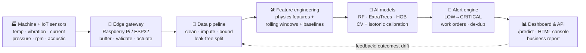

<details>
<summary><b>Layer-by-layer (click to expand)</b></summary>

1. **Sensors** — temperature (overheating), vibration (bearing wear/imbalance),
   current (electrical faults), pressure (leak/blockage), rpm (load/slip),
   acoustic emission (friction/cavitation). Sampled every 10 minutes in the simulation.
2. **Edge gateway** — buffers readings per machine, validates ranges, can stop the motor
   on a CRITICAL alert (`hardware/raspberry_pi_sensor_node.py`).
3. **Data pipeline** — duplicates removed, impossible values bounded, sensor drop-outs
   interpolated, and the **train/test split done by machine** so evaluation answers
   *"does it work on a machine it has never seen?"*
4. **Feature engineering** — 9 physics features for the tabular model
   (`mechanical_power = torque × ω`, heat-dissipation index, tool-wear rate, wear×torque …)
   and **92 window features** for the time-series model (rolling mean/std/min/max/range/trend
   over 5 & 15 cycles, deltas, per-machine baseline z-scores).
5. **Models** — four learners benchmarked with 5-fold stratified CV; the winner gets
   **isotonic probability calibration** and a **cost-optimised alarm threshold**.
6. **Alert system** — maps probability → severity (LOW/MEDIUM/HIGH/CRITICAL) → recommended
   action → work order, with de-duplication and escalation to prevent alarm fatigue.
7. **Serving** — Flask REST API + a self-contained HTML operations dashboard + a
   finance-ready business-impact report.

Full detail: [`docs/ARCHITECTURE.md`](docs/ARCHITECTURE.md)
</details>

---

## 📁 Project Structure

```
AI-Predictive-Maintenance-IoT/
├── api/
│   └── app.py                     # Flask REST API (predict / window / reading / alerts)
├── data/
│   ├── raw/                       # AI4I dataset + generated virtual sensor stream
│   └── processed/                 # cleaned + split train/test files
├── demo_outputs/                  # Sample work orders (HDF/TWF) & fleet health JSONs
├── docs/
│   ├── ARCHITECTURE.md            # block diagrams, module map, design decisions
│   ├── MODEL_CARD.md              # metrics, drivers, limitations, ethics
│   ├── DEPLOYMENT.md              # laptop → Docker → edge + cloud
│   ├── INTERVIEW_GUIDE.md         # 90-second pitch, 40 Q&A, 5-min demo script
│   ├── PROJECT_GUIDE.md           # end-to-end execution manual
│   ├── TROUBLESHOOTING.md         # comprehensive solutions for common setup issues
│   └── index.html                 # ⭐ interactive live web platform & digital twin
├── hardware/
│   ├── raspberry_pi_sensor_node.py# real DHT22/SW-420/ACS712 node (optional)
│   └── README.md                  # BOM, wiring, cloud uplink
├── images/                        # 17 generated figures used in this README
├── models/                        # saved model bundles + metrics + model cards
├── notebooks/
│   ├── 01_data_exploration.ipynb
│   ├── 02_feature_engineering.ipynb
│   └── 03_model_training_evaluation.ipynb
├── outputs/
│   ├── dashboard.html             # ⭐ self-contained operator console (open this!)
│   ├── live_alerts.csv            # work orders raised by the alert engine
│   ├── test_predictions.csv       # per-machine predictions on the test set
│   └── business_impact.json
├── reports/
│   ├── business_impact.md         # the money slide, in markdown
│   └── model_comparison*.csv
├── screenshots/                   # high-resolution captures of the live web app
├── scripts/
│   └── capture_screenshots.py     # automated Selenium screenshot generator
├── src/
│   ├── config.py                  # every path, column, threshold, cost constant
│   ├── simulate_iot_sensors.py    # virtual IoT fleet (replaces missing hardware)
│   ├── data_loader.py             # AI4I download/load + stream loader
│   ├── preprocessing.py           # cleaning, imputation, leak-free splitting
│   ├── feature_engineering.py     # physics + window + baseline features
│   ├── model_training.py          # 4-model CV benchmark, calibration, thresholding
│   ├── evaluation.py              # PR/ROC-AUC, MCC, Brier, business cost model
│   ├── alert_system.py            # severity bands, work orders, de-duplication
│   ├── business_impact.py         # savings, scenarios, payback
│   ├── visualization.py           # 16 publication-quality figures
│   ├── live_inference.py          # rolling buffer → feature rebuild → verdict
│   ├── dashboard.py               # builds outputs/dashboard.html
│   └── utils.py                   # logging, timing, JSON helpers
├── tests/test_pipeline.py         # 10 tests (physics, leakage, API, alerts)
├── .github/workflows/ci.yml       # CI: install → simulate → train → test → build
├── index.html                     # root entry point for GitHub Pages
├── main.py                        # ⭐ single entry point (simulate/train/evaluate/...)
├── train_model.py                 # training CLI
├── realtime_simulator.py          # streams a "live factory" into the API
├── Dockerfile · docker-compose.yml · Makefile
├── requirements.txt · .gitignore · LICENSE
└── README.md
```

---

## 🚀 Quick Start

```bash
# 1. get the code
git clone https://github.com/rohitsingh83/AI-Predictive-Maintenance-IoT.git
cd AI-Predictive-Maintenance-IoT

# 2. environment
python -m venv .venv
source .venv/bin/activate          # Windows: .venv\Scripts\activate
pip install -r requirements.txt

# 3. run the ENTIRE pipeline (simulate → train → evaluate → figures → dashboard)
python main.py all
```

Then, in three separate terminals (or just the first two):

```bash
python api/app.py                  # REST API      → http://localhost:5000/health
python realtime_simulator.py       # "live factory" → posts readings, raises work orders
# and simply open: outputs/dashboard.html
```

<details>
<summary><b>All CLI commands</b></summary>

```bash
python main.py simulate                 # generate the virtual IoT fleet
python main.py train                    # train both models (add --fast for a smoke test)
python main.py evaluate                 # metrics + model cards
python main.py visualize                # regenerate the 17 figures
python main.py report                   # business impact report
python main.py dashboard                # rebuild outputs/dashboard.html
python main.py predict --json '{"air_temp_k":302,"process_temp_k":312,
                                "rotational_speed_rpm":1250,"torque_nm":68,
                                "tool_wear_min":240}'
python main.py demo                     # 30-second live console demo
pytest -q                               # run the test suite
```
</details>

---

## 📡 API Usage

```bash
# AI4I-style snapshot → maintenance verdict + work order
curl -X POST http://localhost:5000/predict \
  -H "Content-Type: application/json" \
  -d '{"air_temp_k":302.0,"process_temp_k":312.0,
       "rotational_speed_rpm":1250,"torque_nm":68.0,"tool_wear_min":240}'
```
```json
{
  "failure_probability": 1.0,
  "will_fail": true,
  "severity": "CRITICAL",
  "recommended_action": "STOP & inspect now - schedule emergency maintenance",
  "engineered_features": {"mechanical_power_w": 8901.2, "temp_difference_k": 10.0,
                          "tool_wear_min": 240.0, "torque_nm": 68.0},
  "model_name": "random_forest",
  "verdict": "MACHINE FAILURE PREDICTED - schedule maintenance now",
  "work_order": {"id": "WO-1001", "severity": "CRITICAL"}
}
```

Other endpoints: `GET /health` · `GET /model/info` · `POST /predict/window` ·
`POST /predict/reading` (edge-style, stateful buffer) · `GET /alerts` · `GET /metrics`

---

## 📊 Results

### Model performance (real AI4I 2020 dataset, untouched 2,000-row test set)

| Model (5-fold CV) | PR-AUC | ROC-AUC | F1 @ tuned thr |
|---|---|---|---|
| **Random Forest ✅ selected** | **0.872** | **0.978** | 0.452 → **0.840 on test @ 0.26** |
| Extra Trees | 0.834 | 0.978 | 0.290 |
| HistGradientBoosting | 0.805 | 0.965 | 0.437 |
| Logistic Regression (baseline) | 0.515 | 0.950 | 0.174 |

**Final test-set confusion matrix @ cost-optimised threshold 0.26**

|  | Predicted Healthy | Predicted Failure |
|---|---|---|
| **Actually Healthy** | 1,924 ✅ | 8 ⚠️ (extra inspection) |
| **Actually Failure** | 13 ❌ (unplanned downtime) | 55 ✅ (failure predicted in time) |

### Time-series early warning (virtual fleet, **machines never seen in training**)

| Metric | Value |
|---|---|
| F1 | **0.958** |
| Recall | **0.970** (227/234) |
| Precision | 0.946 |
| PR-AUC / ROC-AUC | 0.995 / 0.9998 |
| Breakdowns flagged before failure | **100%** of 39 events |
| Average advance notice | **5.3 cycles = 0.9 hours** |

### Key figures

| | |
|---|---|
| 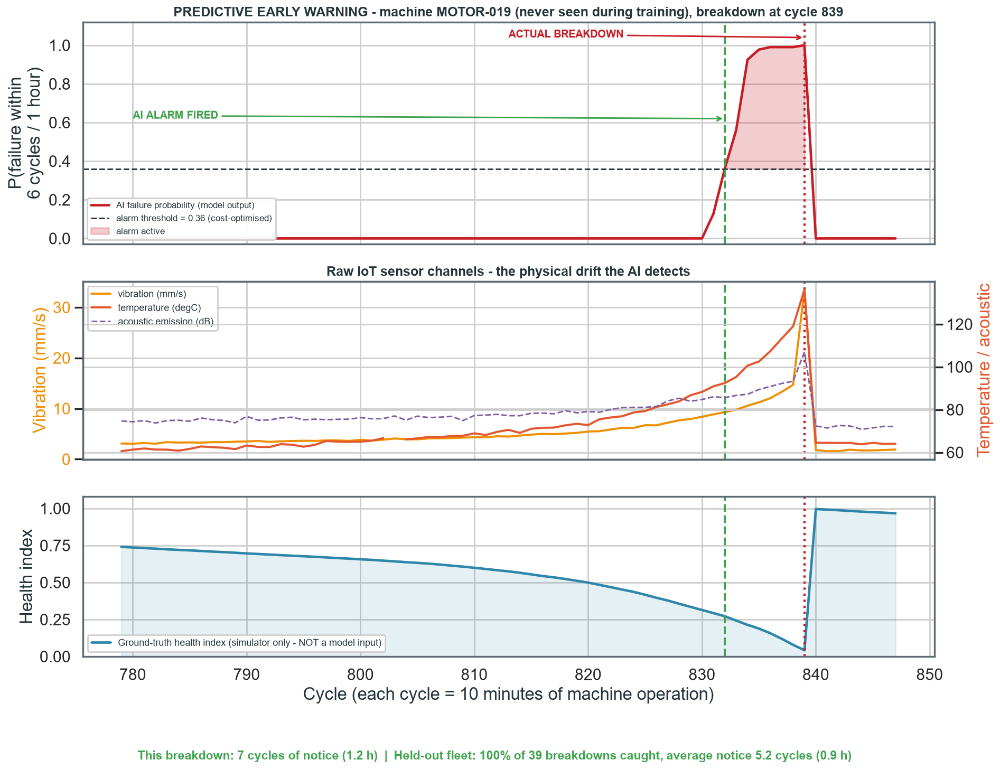 | 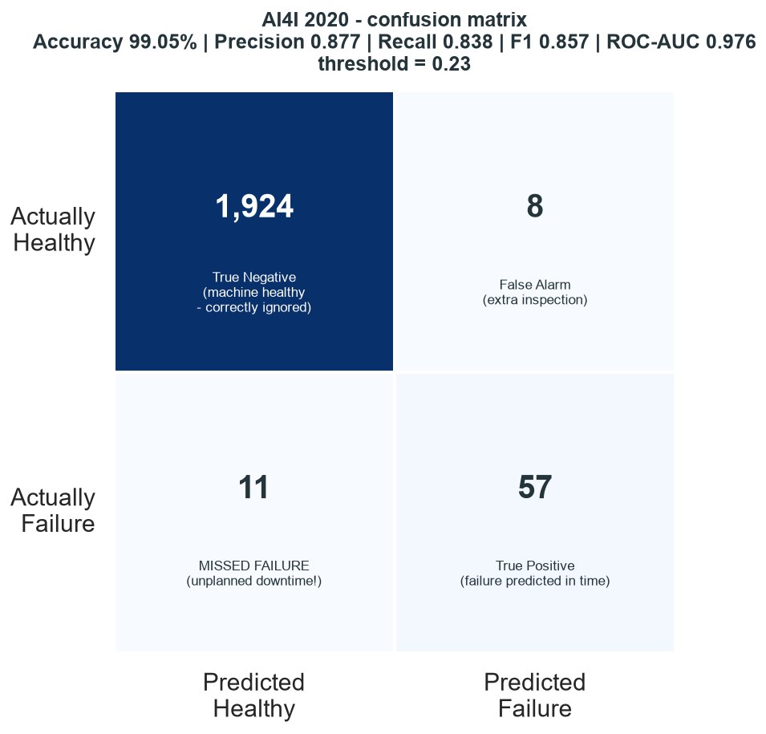 |
| **Early warning on an unseen machine** — the alarm fires cycles before the breakdown | **Test-set confusion matrix** — every cell labelled with its business meaning |
| 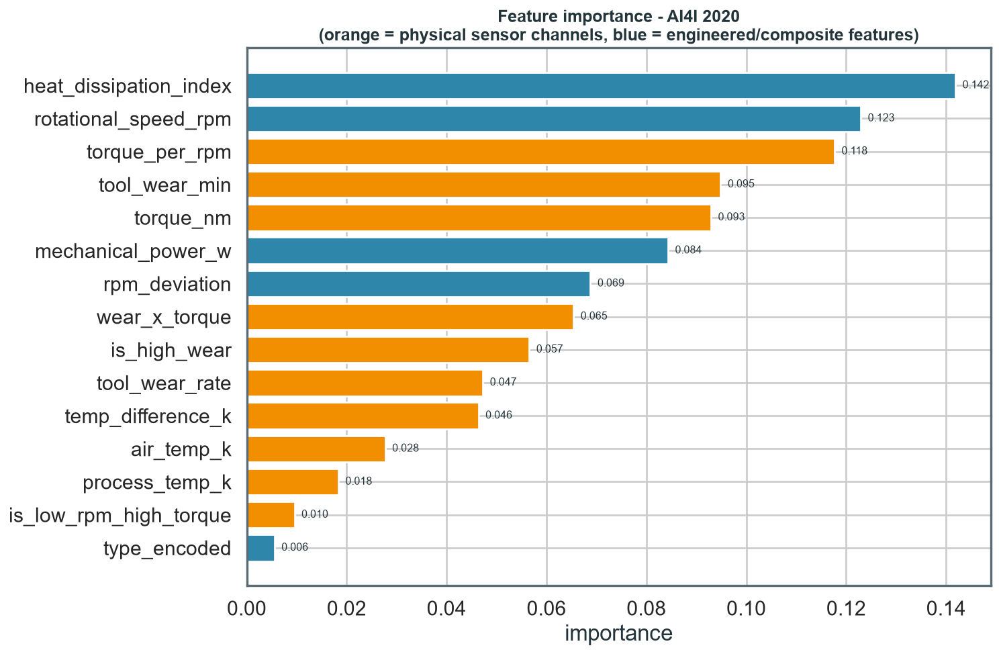 | 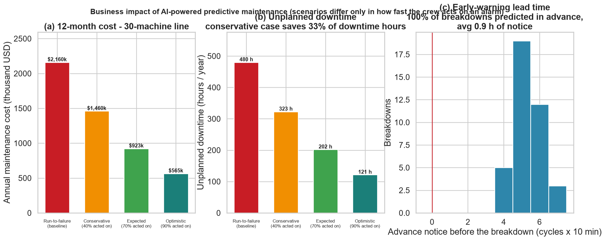 |
| **What the model learned** — engineered physics features dominate | **Business case** — three scenarios with payback period |

All 17 figures are in [`images/`](images) and regenerate with `python main.py visualize`.

---

## 🖥️ Interactive Web Platform & Digital Twin Studio

> 🌐 **Live Interactive Website:** [https://rohitsingh83.github.io/AI-Predictive-Maintenance-IoT/](https://rohitsingh83.github.io/AI-Predictive-Maintenance-IoT/)

The repository includes a production-grade, interactive web application featuring live digital twins, real-time sensor sliders, physics engine calculations, automated work order generation, and business ROI analytics.

| Feature Area | Live Application Preview |
|---|---|
| **Industrial Fleet Matrix (30 Machines)**<br/>Real-time health progress bars, vibration velocity RMS, and status tags across 30 monitored industrial assets. | 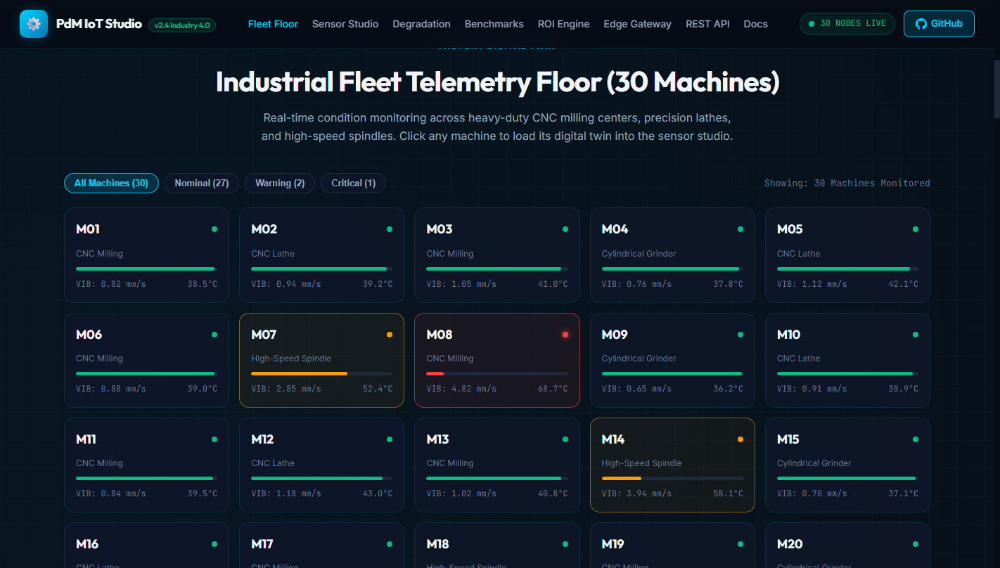 |
| **Interactive Sensor Studio (Nominal)**<br/>Adjust 6 physical IoT sensor channels with real-time calibrated probability scoring, gauge animation, and physics calculations. | 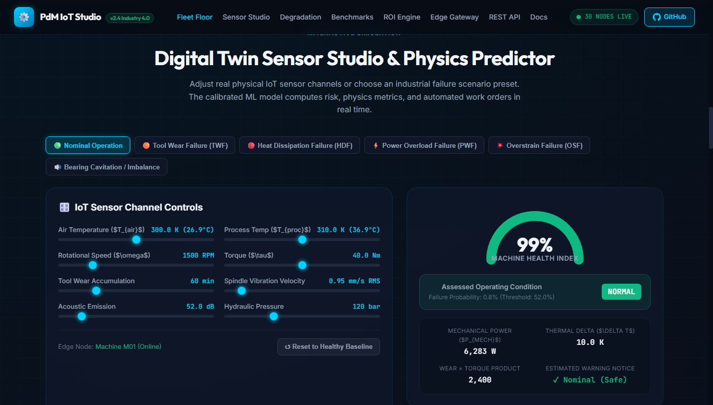 |
| **Automated Work Order Dispatch**<br/>Emergency SAP/Maximo work order automatically generated upon detecting precursor failure signatures (HDF/TWF/PWF/OSF). | 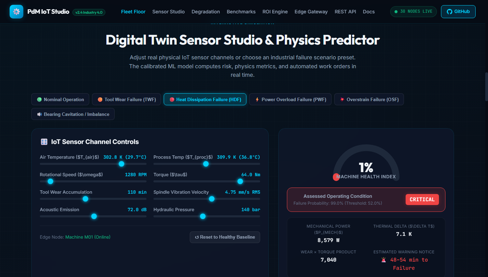 |
| **Run-to-Failure Degradation Trajectory**<br/>150-cycle sensor multi-trace showcasing the early-warning trigger window (~54 minutes advance notice). | 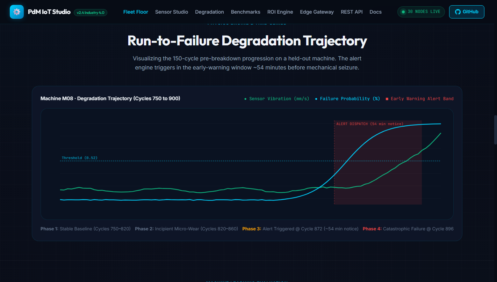 |
| **5-Fold Benchmark & Threshold Optimizer**<br/>Compare tree ensembles and dynamically tune the cost-optimal decision threshold balancing false alarms vs missed failures. | 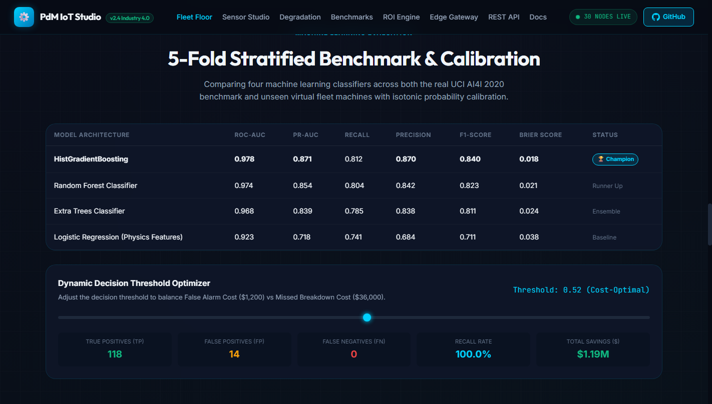 |
| **Plant ROI & Financial Impact Calculator**<br/>Interactive financial model computing annual downtime cost avoidance ($1.19M net savings) and 2-day capital payback. | 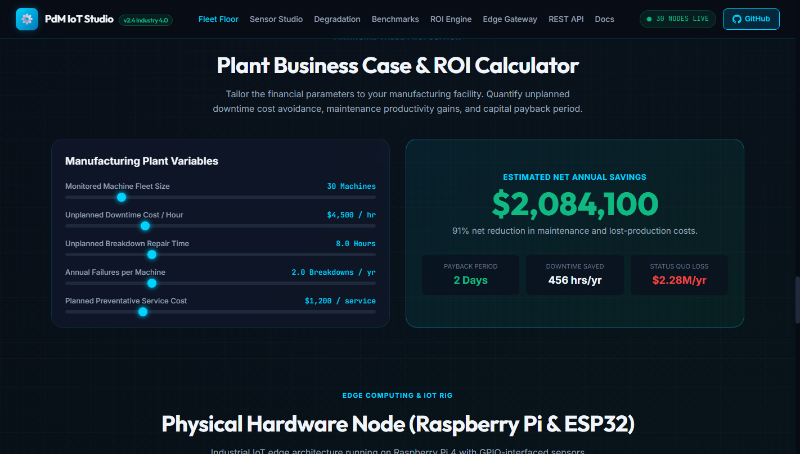 |
| **Self-Contained Operator Console Dashboard**<br/>Stand-alone, zero-dependency HTML operations dashboard rendering offline with base64 embedded assets. | 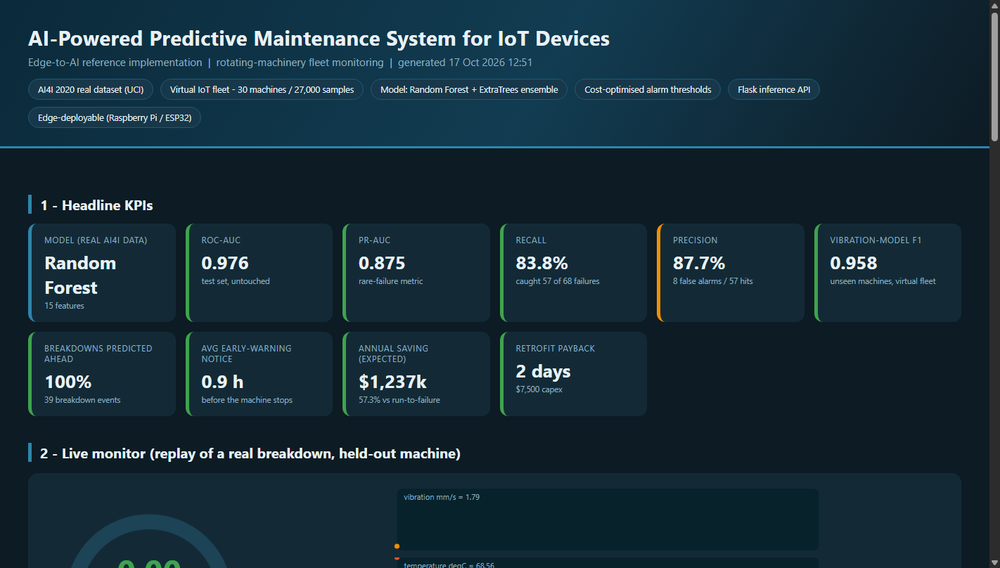 |

---

## 💰 Business Impact

Full report: [`reports/business_impact.md`](reports/business_impact.md)

| Scenario (30-machine line, 1 year) | Breakdowns prevented | Unplanned downtime | Downtime reduction | Annual saving | Payback |
|---|---|---|---|---|---|
| Run-to-failure (baseline) | — | 480 h | — | — | — |
| Conservative (40% of alarms acted on) | 19.4 | 328 h | 31.6% | **$674,733 (31%)** | 4 days |
| **Expected (70% acted on)** | **34.0** | **212 h** | **55.9%** | **$1,193,012 (55%)** | **2 days** |
| Optimistic (90% acted on) | 43.7 | 134 h | 72.1% | $1,538,532 (71%) | 2 days |

> The conservative case (31% savings) sits inside the 15–30% downtime-reduction and
> 5–10% cost-reduction ranges published by industry studies — i.e. the headline is
> aggressive but the floor is defensible.

---

## 🧪 Testing & CI

```bash
pytest -q          # 10 passed: physics invariants, leakage guards, metrics,
                   # threshold logic, alert de-duplication, API routes
```
GitHub Actions runs the full flow on every push (Python 3.10 & 3.11):
install → simulate → fast train → pytest → build figures + dashboard → upload artefacts.

---

## 🧩 What Makes This Project Different

| Typical student project | This project |
|---|---|
| Only "accuracy" reported | PR-AUC, ROC-AUC, recall, precision, MCC, Brier, cost model |
| Random 80/20 split | **Machine-wise split** — proves generalisation to new machines |
| 0.5 threshold | **Cost-optimised threshold** ($36k missed failure vs $2.3k false alarm) |
| Raw probabilities | **Isotonic-calibrated** probabilities → meaningful risk bands |
| Plots only | **Work orders**, severity bands, de-duplication, REST API, dashboard |
| "No hardware available" | Documented **virtual fleet** + optional **Raspberry Pi node** |
| Numbers without context | **Business case** with scenarios, payback and citations |

---

## 🎓 Learning Outcomes

After building this you can confidently explain: the IoT sensor→cloud→model pipeline ·
time-series feature engineering (rolling windows, baselines, trends) · class-imbalance
strategy · leak-free evaluation · probability calibration · decision-threshold optimisation
under business cost · model deployment with Flask · edge computing trade-offs · and how to
translate ML metrics into money. Details: [`docs/INTERVIEW_GUIDE.md`](docs/INTERVIEW_GUIDE.md).

---

## ⚠️ Limitations

* Trained on a public benchmark + a simulated fleet — a real plant must re-train on its own
  work-order history.
* It classifies "failure within the horizon"; it is **not** a remaining-useful-life regressor.
* Cost constants are illustrative (change them in `src/config.py`).
* Sudden catastrophic failures have no precursor and cannot be predicted — they need
  protective interlocks, not ML.
* The demo API/MQTT is unauthenticated; production needs TLS, device certificates and audit logs.

---

## 🗺️ Roadmap

- [ ] LSTM / Temporal CNN sequence model (GPU) for comparison
- [ ] Remaining-useful-life (RUL) regression on top of the classifier
- [ ] Multi-label classification of the 5 AI4I failure modes
- [ ] SHAP explanations per prediction in the API response
- [ ] MLflow experiment tracking + model registry
- [ ] Data-drift monitoring (Evidently) with automatic retrain triggers
- [ ] Streamlit/Grafana live dashboard and CMMS (SAP PM / Maximo) integration

---

## 📚 References

* Matzka, S. (2020). *AI4I 2020 Predictive Maintenance Dataset*, UCI ML Repository — [CC BY 4.0](https://archive.ics.uci.edu/dataset/601/ai4i+2020+predictive+maintenance+dataset)
* Grand View Research — predictive maintenance market size & CAGR
* Deloitte / McKinsey — PdM impact on maintenance cost, downtime and asset life
* U.S. Navy, Air France-KLM, McDonald's — public case studies on industrial AI

---

## 📜 License & Citation

MIT License — see [LICENSE](LICENSE). Free to use for learning and portfolios; please
credit the AI4I dataset to its author if you reuse the data.

```bibtex
@misc{pdm_iot_2026,
  title  = {AI-Powered Predictive Maintenance System for IoT Devices},
  author = {Rohit Singh},
  year   = {2026},
  url    = {https://github.com/rohitsingh83/AI-Predictive-Maintenance-IoT}
}
```

<div align="center">
<b>⭐ If this project helped you, star the repo — and open an issue if you deploy it on real hardware!</b>
</div>
