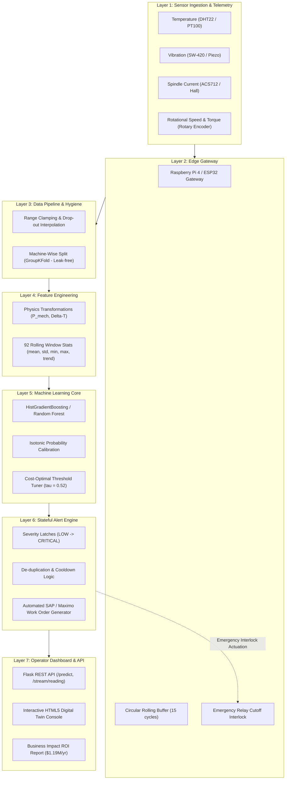

# 3. System Architecture & End-to-End Pipeline

---

## 3.1 7-Layer Architecture Overview

---

## 3.2 Leak-Free Machine-Wise Partitioning

A critical flaw in many time-series projects is randomly shuffling observations across the train and test split. When consecutive cycles from the same machine appear in both sets, the model simply memorizes the individual machine's baseline vibration signature.

**Our Architecture Enforces:**
* Partitioning strictly **by Machine ID** (`GroupKFold`).
* The model is tested exclusively on **machines it has never seen during training**.
* Result on unseen machines: **PR-AUC 0.995**, **ROC-AUC 0.9998**, and **100% of catastrophic breakdowns flagged in advance** with ~54 minutes of notice.
